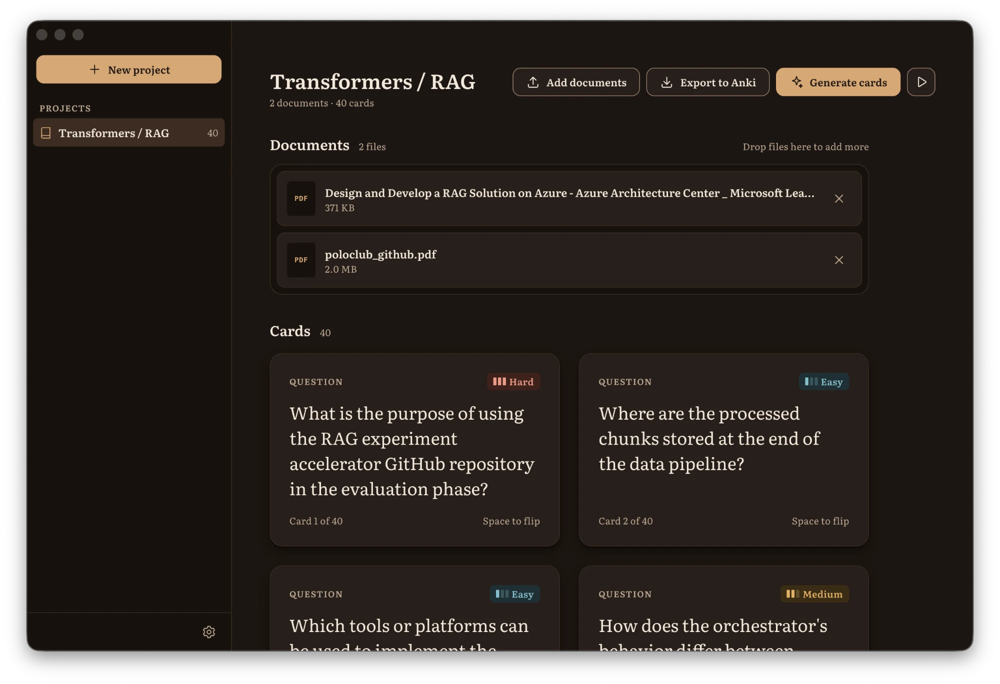

# Retain

**Turn your notes, papers and textbook chapters into flashcards.**

Retain is a desktop app for studying. Drop in your documents, and it uses an AI model to write question-and-answer flashcards from them. You can then study the cards one at a time, flip them, and sort them by how hard they are.



> **macOS only for now.** Retain runs on Apple Silicon (M-series) and Intel Macs. Windows support is planned.

## What it does

- **Projects:** keep each subject or course separate, with its own documents and cards.
- **Documents:** add PDF, Word (`.docx`), Markdown, plain text and EPUB files by dropping them in or browsing. Scanned PDFs (pictures of pages with no selectable text) aren't supported yet.
- **Card generation:** choose how many cards to write per document and how difficult they should be: easy, medium, hard, or a random mix. Each card notes the page it came from.
- **Study mode:** the play button opens your cards one at a time. Flip with Space, step through with the arrow keys, jump to a random card, and move a card to easy, medium or hard as you go.
- **Two themes:** Latte (light) and Roast (dark).

Your projects, documents and cards stay on your Mac. Nothing is uploaded except the text sent to the AI model when you click **Generate cards** (see below).

Coming later: export to Anki, and summaries of each document.

## Install

1. Download the `.dmg` for your Mac from the [latest release](https://github.com/krispaulbabu/flashcard-gen/releases):
   - `Retain-…-mac-arm64.dmg` for Apple Silicon (M1, M2, M3 and later)
   - `Retain-…-mac-x64.dmg` for Intel Macs

   Not sure which you have? Open the Apple menu → About This Mac and look at **Chip** (Apple M…) or **Processor** (Intel).
2. Open the `.dmg` and drag **Retain** into **Applications**.
3. The first time you open it, macOS will say it can't verify the developer, because the app isn't signed with a paid Apple Developer ID yet. To open it anyway, either:
   - right-click **Retain** in Applications and choose **Open**, then **Open** again, or
   - go to **System Settings → Privacy & Security**, scroll down and click **Open Anyway**.

   You only need to do this once.

## How the AI part works

Retain doesn't run an AI model itself. It uses **[OpenRouter](https://openrouter.ai)**, a service that gives you one account and one API key for models from many companies (Anthropic, OpenAI, Google, Meta and others).

When you click **Generate cards**:

1. Retain reads the text out of each document on your Mac.
2. It sends that text to OpenRouter with instructions to write flashcards, along with the model you picked and your API key. Long documents are split into parts and sent in a few requests at once.
3. OpenRouter passes the request to that model's provider, and the model replies with cards in a fixed format.
4. Retain checks each reply, asks once more if a reply doesn't match the format, removes duplicate questions and saves the cards.

You pay OpenRouter for what the model processes, usually a small amount per document. The price depends on the model and how long the documents are; each model's page on OpenRouter lists its price.

**Your API key** is stored encrypted using your Mac's keychain. It's only sent to OpenRouter, and only when generating cards.

### Getting an OpenRouter API key

1. Go to [openrouter.ai](https://openrouter.ai) and sign up. You can use a Google or GitHub account.
2. Add some credit on the [Credits page](https://openrouter.ai/credits). A few dollars goes a long way for flashcards.
3. Open the [Keys page](https://openrouter.ai/keys), click **Create API Key**, give it a name (for example "Retain") and copy the key. It starts with `sk-or-`. OpenRouter only shows it once, so paste it somewhere safe if you need to.
4. In Retain, open **Settings** (the gear at the bottom of the sidebar) → **AI provider**, paste the key into **API key** and press Enter. Retain checks it with OpenRouter and shows **Key verified**.

OpenRouter's own [quick start guide](https://openrouter.ai/docs/quickstart) has more detail.

### Choosing a model

The **Model** field in Settings → AI provider takes an OpenRouter model ID. The default is `anthropic/claude-sonnet-5.5`, which writes good cards and replies quickly.

You can use any model from [OpenRouter's model list](https://openrouter.ai/models), as long as it supports **structured outputs** (use the filter on that page). Copy its ID (shown under the model's name, in the form `company/model-name`) into the Model field.

Free models (IDs ending in `:free`) cost nothing but are often slow or busy. If a model takes more than 90 seconds to reply, Retain stops waiting and shows an error; you can also press **Cancel** at any time.

## Build from source

You'll need [Node.js](https://nodejs.org) 22 or later and [uv](https://docs.astral.sh/uv/) (for the Python backend).

```bash
git clone https://github.com/krispaulbabu/flashcard-gen.git
cd flashcard-gen
npm install
cd backend && uv sync && cd ..
npm run dev
```

`npm run dev` opens the app with live reloading. To build the `.dmg` and `.zip` for your own Mac:

```bash
npm run build:backend
npm run dist
```

The installers are written to `release/`. Pushing a tag like `v0.2.0` (matching `version` in `package.json`) builds both Mac versions on GitHub Actions and attaches them to a draft release.

### How it's put together

- **The app** (`src/`): Electron with React and TypeScript, built with electron-vite. The look follows [DESIGN.md](DESIGN.md).
- **The backend** (`backend/`): a small Python server (FastAPI) that the app starts in the background. It reads documents, calls OpenRouter and stores everything in a SQLite database in `~/Library/Application Support/Retain`.
- **Packaging:** PyInstaller turns the backend into a standalone program, and electron-builder puts it inside the app, so people who install Retain don't need Python.
